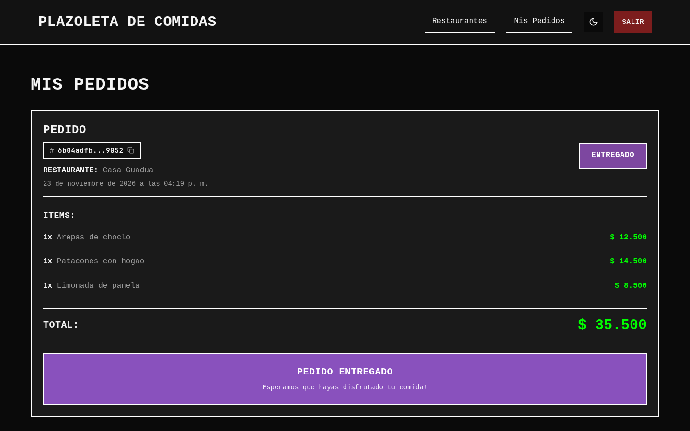
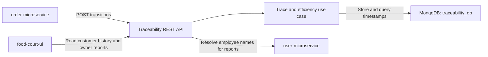

<!-- markdownlint-disable-next-line MD041 -->
<div align="center">

<h1>Food Court — Traceability API</h1>

<p><strong>Order history for customers and fulfillment times for restaurant owners.</strong></p>

<p>
<a href="https://github.com/diegnghtmr/traceability-microservice/actions/workflows/ci.yml"></a>


<a href="LICENSE"></a>
</p>

<p>
<a href="https://diegnghtmr.me/en/work/food-court/"><strong>Case study</strong></a> &bull;
<a href="#quick-start"><strong>Quick start</strong></a> &bull;
<a href="#architecture"><strong>Architecture</strong></a> &bull;
<a href="https://github.com/diegnghtmr/order-microservice"><strong>Order API</strong></a>
</p>

</div>

<p align="center"></p>

*The customer’s orders screen uses Traceability to find order IDs and the Order API to load the current details.*

A current status can tell a diner their order was delivered, but it cannot tell the owner how long fulfillment took. Traceability keeps timestamped transitions from the Order API and uses them to reconstruct customer history and report on completed orders. It does not own or change the current order state.

## Features

- **Transition history.** Store the timestamp and previous and new states sent by the Order API.
- **Customer history.** Return trace entries only when the requested customer ID matches the authenticated caller.
- **Order fulfillment time.** Report elapsed minutes between pending and delivered transitions for orders with both timestamps.
- **Employee reports.** Group completed orders by the employee who took them into preparation and report counts and average duration.
- **Restaurant-scoped reporting.** Require the owner role for efficiency endpoints and select records using the restaurant ID from the authentication context.

## Quick start

Install JDK 25 and Docker with Compose. Start the local MongoDB container; it maps host port `27018`, so Order can keep using `27017`. The Gradle wrapper supplies Gradle 9.2.1.

```sh
git clone https://github.com/diegnghtmr/traceability-microservice.git
cd traceability-microservice
docker compose up -d traceability-mongodb
./gradlew bootRun
```

API: `http://localhost:8093/traceability-api`. Open [Swagger UI](http://localhost:8093/traceability-api/swagger-ui.html) for transition ingestion, customer history, and efficiency endpoints under `/trace`.

| Name | Purpose | Default |
| --- | --- | --- |
| `SPRING_MONGODB_URI` | MongoDB connection URI | `mongodb://localhost:27018/traceability_db` |
| `SPRING_MONGODB_DATABASE` | Transition database name | `traceability_db` |
| `JWT_SECRET` | JWT verification secret | Local development value; use a private value matching Identity outside local development |
| `USER_SERVICE_URL` | Identity API base URL used to resolve employee names | `http://localhost:8090/user-api` |

To populate transitions through the app, start the [Order and Identity APIs](#related-repositories) as part of the Food Court stack. Traceability receives a separate request after an order update; lost calls can leave gaps in the history, so the reports are based only on stored transitions.

## Architecture

REST inputs go through handlers to the domain use case. `TraceMongoAdapter` implements the persistence port, `UserHttpAdapter` resolves employee names for reports, and `UserContextAdapter` exposes caller identity and restaurant context to the domain. Order state remains in a different service and database.



See the [system diagrams in the web repository](https://github.com/diegnghtmr/food-court-ui/tree/main/docs) for the wider service and data model.

## Tech stack

| Layer | Technology |
| --- | --- |
| HTTP and security | Java 25, Spring Boot 4.0, Spring MVC, Spring Security, JJWT |
| Data and integration | Spring Data MongoDB, HTTP client for Identity, MapStruct |
| Build and tests | Gradle 9.2.1, JUnit Platform, springdoc OpenAPI |

## Testing

```sh
./gradlew build
```

[CI](.github/workflows/ci.yml) builds and tests on Temurin 25. Use `./gradlew test` for the test task, including use-case coverage for customer authorization and duration reports.

## Related repositories

| Repository | Role |
| --- | --- |
| [food-court-ui](https://github.com/diegnghtmr/food-court-ui) | Customer order history and owner reports |
| [food-court-microservice](https://github.com/diegnghtmr/food-court-microservice) | Restaurant and dish catalog |
| [user-microservice](https://github.com/diegnghtmr/user-microservice) | JWTs and employee name lookups |
| [order-microservice](https://github.com/diegnghtmr/order-microservice) | Owns current order state and sends transition records |

## License

Released under the [MIT License](LICENSE).
